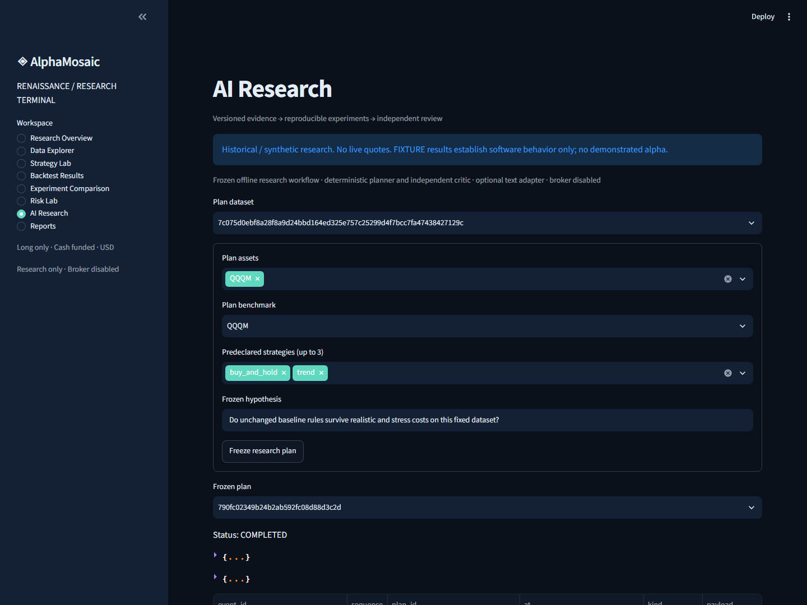
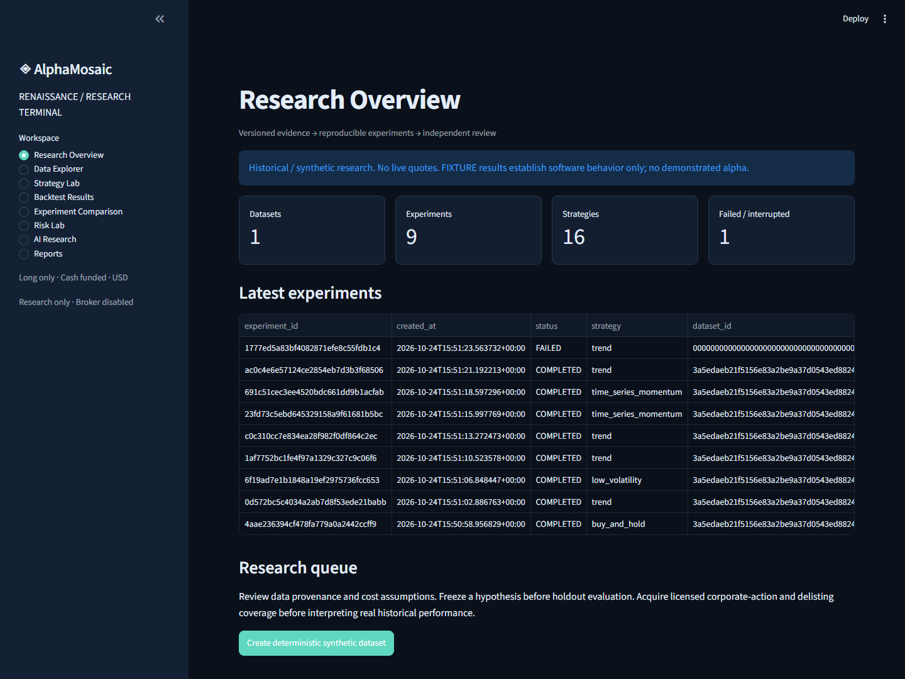
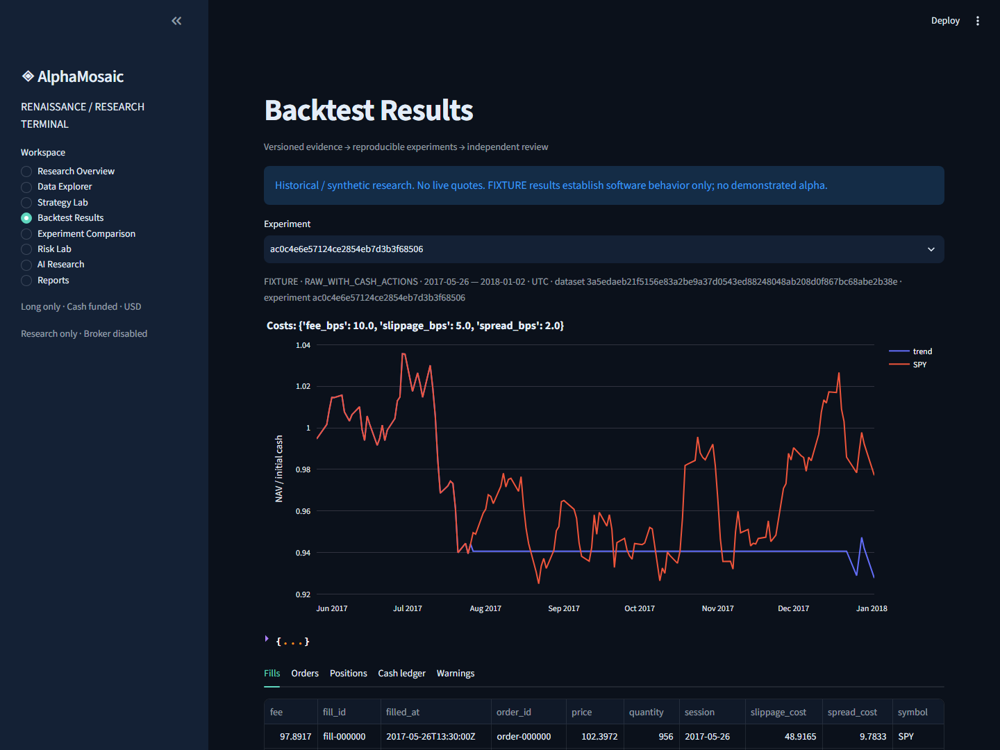
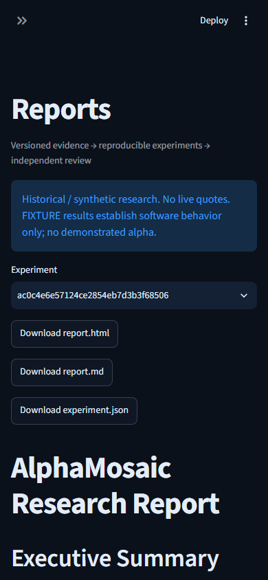

# AlphaMosaic Renaissance — engineering delivery

## Current continuation — 2026-10-25

The full objective remains ACTIVE. Calendar-week strategies/52-period views, independent FIFO/asset accounting and the bounded frozen-plan research workflow are now implemented and verified within their explicit model. The current checkpoint passed267 tests, Ruff/Pyright, real weekly/plan terminal actions, clean base-wheel offline/plan/MCP and browser render gates. Source hash: `af12390cfe9579db641a354fee171afaa6d409c3c6bd56fa770a6f06ceca8f07`.

Read [continuation acceptance](docs/CONTINUATION_ACCEPTANCE_20261025.md), [machine evidence](docs/evidence/continuation-20261025/acceptance.json), [plan evidence](docs/evidence/continuation-20261025/plan-evidence.json) and [weekly FIXTURE report](docs/evidence/continuation-20261025/sample-weekly-fixture-report.md). Prior sections and CI links below are retained historical measurements and do not by themselves certify the current source. New publication/CI must be observed separately. Real-data qualification and the remaining risk/portfolio/statistical/report/model/recovery requirements still prevent a full-platform completion claim.

Date: 2026-10-24 (Asia/Shanghai). Branch: `codex/renaissance-20261024`. Recovered base: `ccd369e`. This is a **locally verified daily research milestone**, not complete production-grade research acceptance. No real historical strategy return, demonstrated alpha, broker capability or return probability is claimed.

## 1. Original architecture and recovery

The root checkout was an older dirty audit branch. Four Renaissance worktrees already contained partial work. Those changes and all other worktrees/runtime evidence were preserved; work continued in `runtime/renaissance-20261024`. The validated baseline provided ApplicationService, read-only research adapters, causal paper replay, optional analytics, evaluation/forward stores and72 passing tests. See CURRENT_STATE_AUDIT.md for evidence categories/severity and actual defects rather than filename-based feature claims.

## 2. Final architecture, retained and new modules

One ApplicationService orchestrates CLI/MCP/optional Streamlit. Existing contracts, OpenBB isolation, scanner, factors, source/risk gates, forward stores and replay are retained. Additions: `data/datasets.py`, richer replay models/events/accounting and fixed strategies, `portfolio/construction.py`, independent `evaluation/analytics.py` and `scientific.py`, `experiments/runner.py`, deterministic `agents/research.py`, research HTML/Markdown reports and `ui/app.py`.

Research inputs, strategy targets, simulated execution, accounting, analytics and presentation stay separate. No arbitrary code/file/broker tool or cross-project credential dependency was added. ModelAdapter is optional; the core needs no paid LLM. The AI planner/orchestrator remains Partially Implemented, not a completed autonomous research team.

## 3. Data and open-source decisions

DatasetStore provides canonical SHA256 versions/manifests, immutable publication, explicit reject/quarantine/warn/provenance policies, corrupt-item visibility, bounded opt-in acquisition and deterministic synthetic data. Missing/unaligned/future/invalid inputs fail closed. Raw/split-adjusted/total-return inputs remain distinct. Network payloads are normalized provider responses and stay local, not a licensed market-data distribution.

One real three-symbol capture requested2024-01-01..2026-10-23: SPY and QQQM each returned706 HISTORICAL bars (2024-01-02..2026-10-23), adjustment UNKNOWN; TLT EMPTY. Overall `PROVIDER_UNAVAILABLE_OR_PARTIAL`, dataset_id null. No replacement data or real return calculation was used. Strict real-data acceptance remains Blocked by PIT, action, historical-universe and delisting evidence.

Framework decisions and primary version/license snapshots are in docs/OPEN_SOURCE_EVALUATION.md. Qlib/LEAN/Zipline are references; VectorBT runtime is rejected under its current Commons Clause restriction; Backtesting.py runtime is rejected under AGPL compatibility concerns. No source copied or paid component installed. NumPy/Pandas/Pydantic/calendar/testing components are reused; Streamlit/Plotly remain optional.

## 4. Replay, accounting and costs

Linked market/signal/order/fill/corporate-action/portfolio events, next-session opening eligibility, configurable delays/lots/fees/slippage/spread/participation, bounded cash-only buys and oversell reservations. Cash ledger, average costs, mark-to-market NAV and append-only split order adjustments are exported. Explicit zero/realistic/stress configurations are available. Financial correctness fixes include nested revalidation, gap-aware buy constraints, delayed overlapping sells and immutable split order revisions.

Independent QA reconstructs48 seeded FIXTURE scenarios and879 fills, including splits/dividends, cash/positions/NAV and causal timestamps. This is independent accounting reconstruction, not independent real execution validation. Daily-volume participation is an ex-post assumption; opening liquidity is unknown. Dividend payment delays, split cash-in-lieu, taxes and delisting economics are not modeled. Market-price drift may exceed target weights and is diagnosed.

## 5. Strategies, metrics and scientific controls

16 registered fixed research strategies include passive/equal weight, trend, time-series/cross-sectional momentum, mean reversion, volatility targeting, risk-adjusted momentum, low volatility and fixed-sleeve ensemble. Optional quality/value/AI/consensus need qualified PIT inputs; absence is not backfilled.

Independent252-session metrics cover return/CAGR/volatility/Sharpe/Sortino/Calmar/drawdowns/duration, descriptive beta/OLS alpha/tracking error/information ratio, exposure/concentration/turnover and explicit costs. Unknown/mismatched benchmark bases, sessions or evidence block comparisons and traces. Closed-lot statistics and genuine factor/asset/cash attribution remain null or Planned.

Chronological train/validation/holdout splits, purge/embargo, train-only standardization, walk-forward fold construction, fixed-block mean uncertainty, local overlapping-holdout contamination audit and sourced-or-missing research-priority inputs are implemented. DSR/PBO/White's Reality Check are Planned. No automatic grade promotion occurs; current experiments remain Exploratory.

## 6. Reproducible cases and reports

Final local suite: `runtime/renaissance-final/suite-0272cec7fb894e7b8c1880b15fc24764.json`; eight successful FIXTURE cases plus one intentionally failed missing-dataset control. A: SPY-labelled synthetic buy-and-hold; B: fixed trend; C: synthetic SPY/QQQM/TLT allocation. Zero/stress controls,42/84 lookback checks and declared holdout are retained without selecting a winner. No market interpretation is permitted.

Each unique experiment includes config.json, dataset manifest/hash, source/dependency/Git/lock fingerprints, accounting/result JSON and CSV, checksum manifest and source-linked HTML/Markdown report. Interrupted runs remain visibly incomplete; failures retain error details. HTML contains local interactive Plotly charts. Full configurations and commands are in REPRODUCIBILITY.md; no screenshot substitutes for runnable evidence. PDF/Parquet export is not claimed.

## 7. Dashboard and visual QA

Eight local terminal pages: overview, data explorer, strategy lab/background jobs, results, comparison, risk, deterministic critic and report downloads. No static price pretends to be live. Browser QA verifies page navigation and renders populated FIXTURE results; AppTest also covers minimum80-row data and empty-result paths. Initial actual screenshot inspection found theme/placeholder issues, which were corrected. Final images and browser scope are in docs/evidence/renaissance-20261024/. This is a local single-user terminal, not a hardened hosted product.

## 8. Measured validation and performance

- Final financial regression: **168 passed**, `-W error::RuntimeWarning`,38.69s. Four visible upstream exchange-calendar deprecation warnings; no coroutine or numerical RuntimeWarning.
- Ruff passed; Pyright0 errors; tracked/nonignored secret-pattern scan passed. Staged-blob scan and final packaging/publication gates are recorded in the release addendum below.
- Real local stdio MCP handshake: protocol2025-11-25,26 research tools, broker_enabled false; remote ChatGPT remains NOT_VERIFIED.
- Small profiled replay:100 sessions×3 assets,0.03972s first replay, exact repeat equality. This is one local measurement with profiler overhead, not a universal performance promise.
- End-to-end instrumented suite:81.306s /101,379,789 peak traced bytes before reducing repeated dependency metadata reads;39.881s /99,497,616 after. All eight result/analytics outputs are compared for equality in software evidence. Different IDs/timestamps and source fingerprints are expected. No algorithmic return/performance optimization was performed. Final non-cProfile suite27.526s is a different instrumentation condition and is not a comparable speedup ratio.
- Dependency audit found43 advisory records affecting2 installed packages (aliases may duplicate records). Upgraded certifi2026.7.22→2026.10.23 and Pillow12.3.0→13.0.0, added explicit minimum requirements; final OSV audit: **no known vulnerabilities found**. Original failure retained locally, with no ignore list.

## 9. Independent review and repaired findings

Independent agents reviewed data quality, accounting, metric formulas, leakage, timeout lifecycle and experiment integrity. Empty checksums, interrupted-state classification, short UI datasets, quarantined selection, spread omission, data/hash identity, source-change detection, unknown benchmark comparison and split adjustment exports were repaired and regression-tested. Danelfin coroutine allocation was traced to cancelled MCP transport tasks; lifecycle now uses same-task scope cleanup and preserves caller cancellation. Corrupt datasets remain listed while replay rejects them.

## 10. Acceptance status and highest-value next work

Implemented & Verified locally: immutable offline data, financial replay/accounting/costs, causal failure tests, fixed cases, independent core metrics, local scientific controls, versioned experiments, reports, core without paid LLM, terminal navigation/render, independent QA and research-only tool boundaries.

Implemented but separately Unverified: externally hosted CI until an actual successful run, remote ChatGPT calls, actual authorized external model/provider integrations and real-market execution assumptions.

Partially Implemented: complete AI research workflow, full strategy/risk dashboard workflows and comprehensive robustness/attribution. Planned: weekly studies, matched closed trades, full covariance/sector optimization and advanced selection-adjusted statistics. Blocked: strictly qualified real historical three-asset research. No overall completion percentage masks these gates.

Next highest value: qualify a licensed raw-plus-actions historical snapshot with delisting/membership evidence, independently validate its accounting/return basis, then rerun unchanged predeclared cases. Full planner/complex optimization follows these gates, not before them.

## 11. Commits, PR and release addendum

Integrated commits: b57986e(data),5eb771e/afc3d45(validation),31ebdde(accounting),b3abff4(independent QA),4ca05a6(async lifecycle). Final integration commit, clean-wheel results, staged scan, remote branch SHA/PR and hosted CI are appended after execution. GitHub connector authenticated SiriZhao with ADMIN/push rights; existing repository is public and visibility unchanged. GitHub CLI token remains invalid; Git transport authentication is an independent gate. No force push or main rewrite is permitted.

### Local release gates executed

Measured evidence: [acceptance.json](docs/evidence/renaissance-20261024/acceptance.json), [JUnit](docs/evidence/renaissance-20261024/pytest.xml), [dependency audit](docs/evidence/renaissance-20261024/dependency-audit.json), [sample FIXTURE report](docs/evidence/renaissance-20261024/sample-fixture-report.md). Source hash `06ee532642910d385759c6ca9ceb751d6946119914777e7690dcb680faba5a8e`.

Build produced `runtime/delivery-build-final/alphamosaic-0.1.0-py3-none-any.whl` (134,466 bytes) and sdist(283,398 bytes). Archive inspection confirmed no runtime/.venv/credentials/.git paths. Initial unrestricted sdist traversal was stopped after a cache-in-source warning; explicit sdist include paths fixed it. No unknown file was deleted or replaced.

Fresh base-wheel environment installed51 packages from locked base requirements. `verify_wheel.py` confirmed site-packages import, all four optional integrations absent, successful FIXTURE experiment and broker disabled. Doctor and real MCP initialization/tool list/status invocation passed from outside src. Final OSV audit had no findings or skipped records. Profiling optimization preserved exact result and analytics for all eight cases.

Actual screenshot evidence, FIXTURE only:

### Publication verified — 2026-10-25 (Asia/Shanghai)

- Implementation commit `a6dd38e24ab421493ef056d582490abee62d80f8` was pushed normally; `git ls-remote` matched the local SHA. No main or existing worktree was changed.
- [Draft PR #4](https://github.com/SiriZhao/alpha-mosaic/pull/4), stacked on the still-open data-quality PR #3 (`codex/data-quality-20261013`), was created and observed mergeable. The connector's PR write returned403; a separately verified existing Git transport identity/permission successfully created it without exposing or persisting credentials. No paid provisioning or visibility change.
- [Hosted CI](https://github.com/SiriZhao/alpha-mosaic/actions/runs/40135345657) **PASSED**: lock/sync, Ruff, Pyright, tests, offline repeat/performance smoke, real local MCP handshake, build, clean-wheel smoke, dependency audit and secret scan. Machine-readable capture: docs/evidence/renaissance-20261024/ci-implementation.json. Remote ChatGPT remains NOT_VERIFIED.
- Repeated all eight cases from the clean committed implementation: `git_dirty=false`, same source hash, exact result and analytics equality. Timing had an anomalous long interval of unknown cause; raw metadata is retained and excluded from performance claims. See committed-reproduction.json.
- Latest rebuilt distributions at `runtime/release-a6dd38e/` include review evidence; all49 packaged Python files match the clean-wheel-tested code exactly. Runtime exclusion and artifact hashes are in release-build.json. This supersedes the earlier local package output paths for source-archive completeness.
- Documentation-only publication evidence is committed separately after implementation CI; current branch/PR status should be checked against its actual latest commit. Financial/data limitations above remain unchanged and full production-grade research acceptance is still not claimed.
