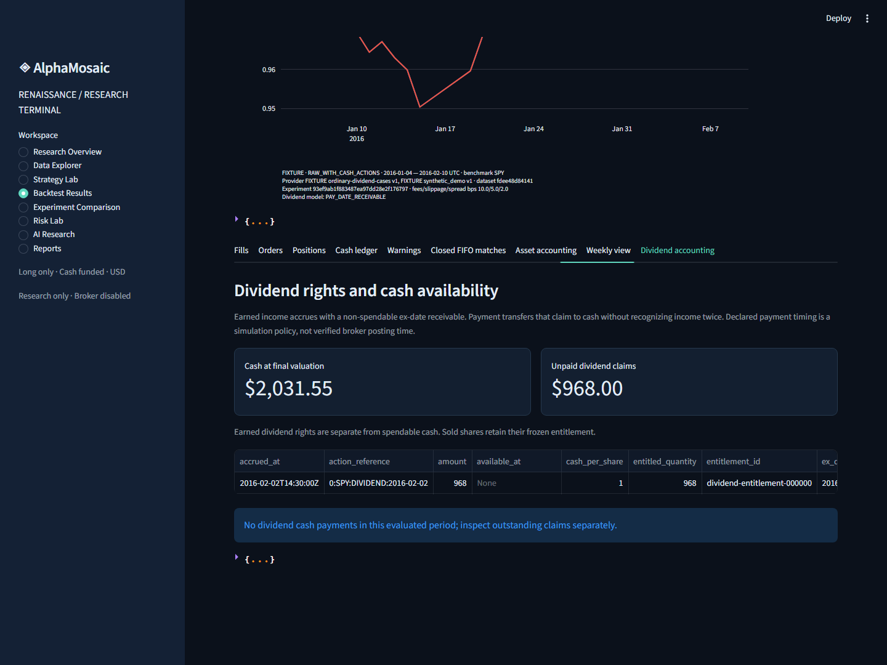
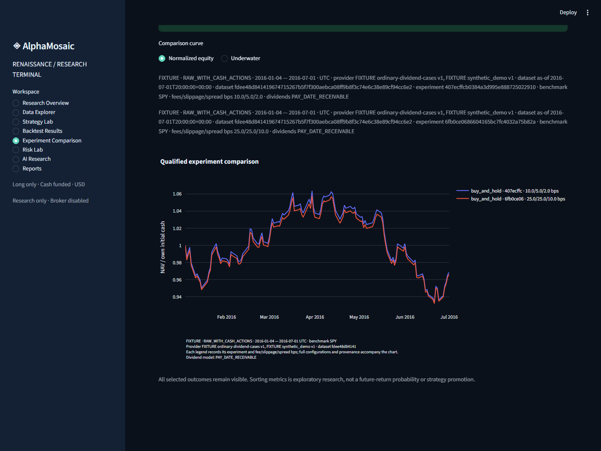

# AlphaMosaic Renaissance — current delivery report

Updated 2026-10-25, Asia/Shanghai. Full objective: **ACTIVE, incomplete**. This report describes the current accepted implementation; timestamped checkpoint evidence remains immutable. No production-grade research acceptance, real historical strategy performance or demonstrated alpha is claimed.

## 1. Verified release identity

Development branch: codex/renaissance-20261024. Latest tested implementation: f9dcfe33e7d9698e1f080a5d5e553567efe2f652. Source SHA256: a26523a908f264868dee7eb4da6a3df92f4ab0b16a2bf65514c52d74b1b1c988.

Local and hosted full regression both passed **361 tests**, with RuntimeWarning treated as error. Local suite had zero failed/error/skipped tests and included both actual Windows junction fixtures. Four upstream calendar deprecation warnings remain visible. [Hosted CI40202837163](https://github.com/SiriZhao/alpha-mosaic/actions/runs/40202837163) passed every quality gate. Evidence-only follow-up commits retain the same source identity and have separate CI observation.

[Draft PR #4](https://github.com/SiriZhao/alpha-mosaic/pull/4) remains stacked on unmerged PR #3. Normal pushes were verified by matching local and remote SHAs; no merge, force push, visibility change or main rewrite occurred. The existing repository is public. Original dirty root files and all independent worktrees were preserved.

## 2. Original audit and retained architecture

The original root checkout was an older dirty audit branch. Partial Renaissance work was recovered in an isolated worktree from ccd369e, preserving concurrent changes. The recovered source had72 passing baseline tests. Source inspection and execution established the baseline; filenames alone were not acceptance.

One authoritative ApplicationService still orchestrates CLI, MCP and optional Streamlit. Existing provenance contracts, isolated provider adapters, scanner/factors, risk gates, forward-evidence stores and replay were retained. Research inputs, fixed strategy targets, simulated execution, portfolio accounting, analytics, experiment storage and presentation remain separate.

New or extended modules include data/datasets.py, backtesting models/replay/strategies, portfolio/construction.py, evaluation analytics/scientific/trades/weekly, experiments/runner.py, bounded agents/workflow.py and agents/worker.py, reporting/research.py and the local terminal. Core computation has no UI or paid-model requirement. See [architecture](ARCHITECTURE.md) and [audit with reproduced severity findings](CURRENT_STATE_AUDIT.md).

## 3. Data engineering and licensing

Versioned local datasets retain canonical content hashes, manifests, provenance, source/adjustment/calendar/timezone metadata, quality findings and explicit Reject/Quarantine/Warn/Accept-With-Provenance policy. Corrupt, quarantined, mixed FIXTURE/observed, future, invalid or unaligned evidence fails closed. RAW, split-adjusted and total-return inputs have distinct contracts; cash dividends cannot augment already adjusted returns.

Corporate actions and dated feature values require an observed or explicitly FIXTURE evidence class. Strict signals need availability qualification, nonempty source and evidence identity. A model comment or self-asserted PIT flag cannot supply observed financial values.

The actual opt-in three-symbol capture requested2024-01-01..2026-10-23: SPY/QQQM each returned706 HISTORICAL rows with UNKNOWN adjustment, while TLT was EMPTY. The capture remained PROVIDER_UNAVAILABLE_OR_PARTIAL and published no research dataset. **Strict real-data acceptance remains Blocked** by qualified licensed raw/actions, historical availability, membership and delisting evidence. No outage was replaced with synthetic market performance.

[Open-source evaluation](docs/OPEN_SOURCE_EVALUATION.md) records primary license/version snapshots captured2026-10-24 and a [LEAN-only live refresh](docs/framework-refresh-20261025.json) on2026-10-25, separating its current master commit from the old GitHub release and untested package/runtime identity. Qlib/LEAN/Zipline remain references; VectorBT runtime is rejected under Apache plus Commons Clause; Backtesting.py runtime is rejected under its AGPL compatibility boundary. No evaluated engine source was copied. NumPy/Pandas/Pydantic/exchange-calendars/Pytest/Hypothesis are reused; Plotly/Streamlit/QuantStats remain optional. Software licenses do not grant market-data redistribution rights.

## 4. Event replay, portfolio accounting and costs

The long-only cash simulation links market, signal, proposed order, fill, corporate-action and portfolio events. Close-derived signals become eligible at later exchange opens. Configurable delays, lot sizes, commissions, spread, slippage and participation limits coexist with cash constraints, reserved sells, missing-bar rejection and immutable split order adjustments. Zero-cost is a comparison control; realistic and conservative stress presets are explicit.

Ordinary USD dividends now freeze pre-fill ex-date rights as fixed earned receivables. Claims contribute to NAV but cannot fund purchases. Cash becomes available at the first XNYS open strictly after the sourced calendar payment date, an explicit conservative simulation convention. Selling, re-entering or splitting holdings does not change a prior dollar right. Income is not recognized again at payment.

Independent FIFO reconstruction checks cash, shares, claims, earned/paid dividends, lot allocations and additive NAV/P&L. Closed economic P&L can include earned unpaid income and is distinguished from cash-realized or tax P&L. Schema3 exports include entitlement/payment/receivable ledgers. Old missing-field configurations and finalized artifacts retain legacy semantics without rewriting; strict real replay refuses legacy immediate dividend cash. Comparisons reject incompatible accounting models even when NAV curves coincide.

Special/due-bill distributions, cash-in-lieu, amendments, taxes, impairment/default, broker settlement and delisting economics are not implemented or certified. Daily volume is an ex-post capacity assumption, not known opening-auction liquidity. Market drift after fills may exceed target weights and is diagnosed. See [assumptions](BACKTEST_ASSUMPTIONS.md), [data model](DATA_MODEL.md) and [payment acceptance](docs/DIVIDEND_PAYMENT_ACCEPTANCE_20261025.md).

## 5. Strategies, construction and analytics

Nineteen registered fixed daily/weekly research rules cover passive/equal weight, trend, time-series/cross-sectional momentum, mean reversion, volatility targeting, risk-adjusted momentum, low volatility and a fixed ensemble. Optional quality/value/AI/consensus inputs require qualified dated evidence; absent values are not backfilled. Weekly signals use complete calendar weeks and later daily-open execution. RAW action-aware weekly signals remain explicitly blocked pending a causal adjustment model.

Basic long-only/no-leverage/cash/asset-weight/turnover controls and transparent simple allocation rules are implemented. Full covariance risk budgeting, sector constraints with reliable classifications and a general constrained optimizer remain Planned.

Daily252-observation and separately qualified weekly52-period analytics expose returns, CAGR, volatility, Sharpe/Sortino/Calmar, drawdowns/duration, descriptive beta/OLS intercept, active statistics, turnover, matched-lot trade statistics, exposure, concentration and explicit costs. Undefined ratios remain null. Cash, marked holdings and receivable weights remain separate. FIFO segments are not independent trades or tax lots.

Risk views include underwater/rolling volatility/Sharpe/beta/correlation, drawdown episodes, complete-date exposure and additive asset/cost evidence. Benchmark dates, return basis, evidence class and accounting model must qualify before comparison. Cash/risk-free and equal-weight benchmark interfaces, genuine sourced factor attribution and advanced portfolio models remain incomplete. Descriptive regression is not causal attribution. See [strategy guide](STRATEGY_GUIDE.md) and [metric definitions](RISK_ANALYTICS.md).

## 6. Scientific validation and research agents

Chronological train/validation/holdout splits, purge/embargo boundaries, train-only standardization, walk-forward fold construction, fixed-block mean uncertainty and overlapping-holdout contamination audits are implemented. A declared historical holdout is not independent prospective validation. Bootstrap diagnostics do not correct repeated selection; DSR/PBO/White's Reality Check remain Planned.

The deterministic planner freezes a hypothesis and at most6 strategy/cost trials, requires a realistic primary case, records dataset/manifest/source versions and retains all outcomes. Fixed subprocess workers have deadlines; MCP jobs are bounded and queued jobs can be cancelled. Independent critics distinguish Evidence, Inference, Hypothesis, Uncertainty and Actionable Research Question. Optional qualitative model commentary cannot introduce numerical results or investment promotion. No paid LLM is required.

Six reproduced dispatch defects were repaired. Planned experiment creation now verifies one pending frozen audit call and canonical config/request/source/manifest under the same global OS lease as execution. Missing context, changed/late/duplicate attempts, original-directory redirection and unidentified/corrupt/unsealed artifacts fail closed. An independent reviewer passed14 dispatch tests; parent full testing included its separately deselected junction case.

Explicit interrupted-plan reconciliation is **not yet integrated**; isolated implementation/review is in runtime/renaissance-recovery-20261025. A recovered complete artifact cannot prove an unobserved original process exit; late immutable responses may arrive after the experiment lock releases. No silent retry or automatic evidence-grade promotion occurs. Adaptive model-driven planning and selection-adjusted statistics remain incomplete. See [methodology](RESEARCH_METHODOLOGY.md) and [dispatch acceptance](docs/RESEARCH_DISPATCH_ACCEPTANCE_20261025.md).

## 7. Reproducible experiments and reports

Unique experiments record full configuration, source/Git/dependency/lock fingerprints, dataset versions, cost/execution/validation assumptions, results, warnings and checksum manifests. Orders/fills/signals/events/cash/positions, FIFO/asset records, weekly equity and dividend ledgers are exportable. Failed and interrupted work remains visible; no result directory is reused.

Runnable FIXTURE cases include A passive SPY-labelled synthetic baseline, B fixed trend, C three-asset allocation, zero/stress cost controls, fixed parameter sensitivity and declared holdout. Extended cases exercise weekly rules and a frozen6-trial plan. Dividend cases retain realistic/stress/full/unpaid/legacy diagnostics, four worker trials and the expected failed RAW-weekly action control. Every synthetic price/result is software evidence only.

Current clean-commit reruns matched all financial replay, benchmark and analysis fields across four direct cases and four worker trials. Critic equality excludes only separately validated record IDs; time/source/Git identity metadata is intentionally distinct. [Reproduction proof](docs/evidence/research-dispatch-20261025/committed-reproduction.json) names the exact records. Reports export JSON/CSV/HTML/Markdown with source-linked caveats; PDF and Parquet export are not claimed.

## 8. Actual dashboard evidence

Eight local pages provide overview, datasets, strategy lab, results, compatible experiment comparison, risk, frozen AI research/critics and downloadable reports. Background jobs expose progress/failure. No old/static price pretends to be live. This is a localhost single-user product.

The payment milestone rendered all eight pages/mobile with13 captures, asserted actual selected compatible/unpaid experiment IDs, and checked the viewer source hash. Current dispatch work changes no UI/report code; those captures retain their original source identity rather than being relabeled as new browser tests. AppTest remains in the current full regression. Broad scenario/robustness controls, active cancellation and comprehensive interaction coverage remain incomplete.

## 9. Quality, security and measured performance

Current local/hosted361-test suites, Ruff, Pyright, lock validation, wheel/sdist, fresh base-wheel workflows, CLI,31-tool stdio MCP, dependency audit and secret scan passed. All59 installed and packaged Python files match the tested source. Fresh base-wheel acceptance excludes OpenBB/QuantStats/Streamlit/Plotly yet completes payment cases and isolated workers. Remote ChatGPT remains NOT_VERIFIED; provider installation health is separate from data validity.

Financial tests cover no phantom constant-price profit, positive-cost loss, cash/share/NAV conservation, split/dividend consistency, insufficient cash/long-only limits, next-open causality, future perturbations, repeated results, missing/misaligned bars, annualization, finite extremes and benchmark basis. Independent accounting, generated constraint cases, failure/corruption/lifecycle tests and frozen worker tests retain original negative evidence.

Earlier profiling measured a100-session/three-asset replay and exact repeat equality. Historical instrumented metadata-cache work reduced a measured suite from81.306s/101,379,789 peak traced bytes to39.881s/99,497,616 while preserving eight outputs; these are named local measurements, not a current universal speedup. Hosted CI runs a lightweight baseline/repeat smoke with no speedup claim. No Numba/Rust/GPU/distributed dependency was added.

There is no agent-accessible broker, arbitrary shell/file reader or credential tool. Optional integrations are isolated and no Meridian credential/runtime dependency is permitted. Original dependency vulnerabilities were repaired without an ignore list; current hosted audit reports no known vulnerabilities. Local hashes/leases are single-user integrity controls, not hostile multi-tenant authentication. See [security](SECURITY.md), [tests](TESTING.md) and [risk register](docs/RISK_REGISTER.md).

## 10. Run locally

Use Python3.12 in the reviewed development checkout. These commands require no model/broker key and create only local research artifacts:

    uv sync --locked --all-extras --dev
    uv run alphamosaic doctor
    uv run python scripts/run_research_cases.py --home runtime/new-research
    uv run python scripts/run_extended_research.py --home runtime/new-weekly-research
    uv run python scripts/run_dividend_cases.py --home runtime/new-dividend-research
    $env:ALPHAMOSAIC_HOME = (Join-Path (Get-Location) 'runtime/new-dividend-research')
    uv run python -m streamlit run src/alphamosaic/ui/app.py --theme.base dark

Quality commands:

    uv run ruff check .
    uv run pyright
    uv run pytest -q -W error::RuntimeWarning
    uv build
    uv run python scripts/mcp_smoke.py --home runtime/new-mcp-check

Choose a unique home for a new case suite. Freeze source/environment and restart services before acceptance. Fixed-plan source/data changes require a newly reviewed plan; incomplete attempts never authorize silent replay. More commands and export conventions are in [reproducibility](REPRODUCIBILITY.md).

## 11. Status and remaining acceptance

- **Implemented & Verified:** research-only shared service, local versioned data/quality gates, causal paper replay, ordinary-dividend claim/payment accounting, explicit costs, fixed daily/qualified weekly rules, independent metrics/FIFO accounting, chronological controls, experiment/report storage, local terminal, frozen offline workflow/critics, dispatch safety, tests/build/clean wheel/current implementation CI.
- **Implemented but Unverified externally:** remote ChatGPT, authorized optional model/provider integration and real opening-liquidity assumptions. Local MCP or an installed provider is insufficient proof.
- **Partially Implemented:** broader portfolio/risk/robustness/benchmark/attribution workflows, adaptive AI research and all-interaction terminal coverage.
- **Planned / isolated development:** explicit interrupted-plan reconciliation, cash-in-lieu/special/delisting economics, causal RAW weekly adjustment, covariance/sector optimization, selection-adjusted statistics, richer scenario controls and PDF/Parquet export.
- **Blocked:** strictly qualified licensed real historical three-asset/PIT/actions/universe/delisting research. No FIXTURE result, heuristic rank or descriptive alpha bypasses this gate.

Production-grade research-prototype acceptance is incomplete. The next feasible safety task is independently reviewed append-only reconciliation; the highest-value external prerequisite remains licensed qualified raw-plus-actions historical evidence. Subsequent work must preserve financial correctness, all failed experiments and immutable forward evidence rather than optimize attractive curves.

## 12. Commits and immutable checkpoint index

Important integrated milestones: a6dd38e initial research prototype; a583a1e weekly/FIFO/frozen workflow;02133ef risk/comparison;96d18e3 presentation preparation;22c7617 ordinary-dividend core;c63deb9 source-qualified payment acceptance;f9dcfe3 frozen dispatch safety. Publication/evidence-only commits are recorded in Git history and the linked bundles; none upgrades market evidence.

- [Initial audit, cases, profiling and release evidence](docs/evidence/renaissance-20261024/acceptance.json).
- [Weekly/FIFO/frozen workflow acceptance](docs/CONTINUATION_ACCEPTANCE_20261025.md).
- [Risk terminal acceptance](docs/TERMINAL_RISK_ACCEPTANCE_20261025.md).
- [Payment source/wheel/browser acceptance](docs/evidence/dividend-payment-20261025/acceptance.json) and [its CI](docs/evidence/dividend-payment-20261025/hosted-ci.json).
- [Current dispatch local/independent/wheel acceptance](docs/evidence/research-dispatch-20261025/acceptance.json), [CI](docs/evidence/research-dispatch-20261025/hosted-ci.json) and [clean reproduction](docs/evidence/research-dispatch-20261025/committed-reproduction.json).
- [Implementation dependencies](docs/IMPLEMENTATION_PLAN.md), [recoverable progress](docs/PROGRESS.md), [next steps](NEXT_STEPS.md) and [draft PR #4](https://github.com/SiriZhao/alpha-mosaic/pull/4).

Older report versions remain in Git history; their measurements belong to their named commits, not automatically to the current tree.
