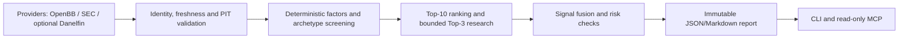

# Architecture

AlphaMosaic is a modular monolith with one authoritative `ApplicationService`. The CLI and
MCP server call that service; they do not implement separate decision logic. Domain contracts
in `core` are Pydantic models and contain provenance, timestamps, data-quality labels and
point-in-time checks.

`providers` implements the `DataProvider` protocol. The OpenBB V5 adapter starts a bounded
worker process and exchanges JSON over stdin/stdout. The worker owns OpenBB configuration in a
repository-local runtime directory and never reads ambient credentials. `screening`, `factors`,
`portfolio`, `backtesting` and `evaluation` contain deterministic research logic. `reporting`
stores unique, schema-validated JSON and Markdown run bundles.

External research and backtest frameworks cross an explicit adapter boundary. The framework
matrix records adapter presence, dependency installation, startup, computation and validation as
separate facts. `PaperReplayEngine` is the local execution authority; QuantStats consumes its
returns for independent statistics but does not create fills. LEAN remains an isolated CLI/process
boundary until an operator supplies Docker, a pinned project and licensed data. Large ML/RL and
license-sensitive packages are never imported into the core environment by default.

`ForwardPaperStore` is an append-only paper-evidence boundary. Signal fields are source-hashed and
immutable; T+5/T+20/T+60 outcomes use only bars after the frozen cutoff and frozen cost assumptions.
Forward observations cannot mutate historical signals, create broker orders or be reported as
real-account returns.

No module can create broker orders. MCP exposes six read-only tools and has no arbitrary file,
shell, credential or order surface. AI-generated commentary is not accepted as a market
observation.

## Integrated release boundary

The opportunity pipeline is an additive orchestration path under the existing
`ApplicationService`. Optional model and commercial providers are isolated behind
adapters, and unavailable evidence is represented explicitly rather than replaced by
fixtures. The release remains research and paper-evaluation only.
