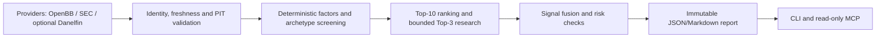

# Architecture

AlphaMosaic is a modular monolith with one authoritative `ApplicationService`. The CLI and
MCP server call that service; they do not implement separate decision logic. Domain contracts
in `core` are Pydantic models and contain provenance, timestamps, data-quality labels and
point-in-time checks.

`providers` implements the `DataProvider` protocol. The OpenBB V5 adapter starts a bounded
worker process and exchanges JSON over stdin/stdout. The worker owns OpenBB configuration in a
repository-local runtime directory and never reads ambient credentials. `screening`, `factors`,
`portfolio`, `backtesting` and `evaluation` contain deterministic research logic. `reporting`
stores unique, schema-validated JSON and Markdown run bundles.

External research and backtest frameworks cross an explicit adapter boundary. The framework
matrix records adapter presence, dependency installation, startup, computation and validation as
separate facts. `PaperReplayEngine` is the local execution authority; QuantStats consumes its
returns for independent statistics but does not create fills. LEAN remains an isolated CLI/process
boundary until an operator supplies Docker, a pinned project and licensed data. Large ML/RL and
license-sensitive packages are never imported into the core environment by default.

`ForwardPaperStore` is an append-only paper-evidence boundary. Signal fields are source-hashed and
immutable; T+5/T+20/T+60 outcomes use only bars after the frozen cutoff and frozen cost assumptions.
Forward observations cannot mutate historical signals, create broker orders or be reported as
real-account returns.

No module can create broker orders. MCP exposes typed research tools and has no arbitrary file,
shell, credential or order surface. AI-generated commentary is not accepted as a market
observation.

## Integrated release boundary

The opportunity pipeline is an additive orchestration path under the existing
`ApplicationService`. Optional model and commercial providers are isolated behind
adapters, and unavailable evidence is represented explicitly rather than replaced by
fixtures. The release remains research and paper-evaluation only.

## Data-quality contracts

ScanReport schema 2.0 stores raw adapter snapshots as audit inputs, distinct from
validated factor evidence. Null-volume benchmarks use price-only validation; stock
volume-dependent factors abstain. SPY/QQQM validation and NO_ACTION are independent
of report-verification/software status. Immutable reports publish by staging and
atomic rename; explicit-run derived bundles record input/source/generator hashes.
Legacy report formats remain readable without fabricating a runtime source version.

## Renaissance local research boundary

CLI / MCP / optional Streamlit all call ApplicationService. Its single bounded ExperimentRunner
loads immutable DatasetStore snapshots, passes available observations to fixed StrategyRegistry
rules, and delegates simulated execution/accounting to PaperReplayEngine. The engine emits linked
signals/orders/fills/actions, append-only order adjustments, cash entries and valuation snapshots.
Independent analytics consume those results without importing OpenBB, UI or MCP internals.
Chronological scientific controls and holdout audit are separate from execution. Local experiment
stores persist config, source/dependency/data fingerprints, full accounting exports and reports;
failed/interrupted work stays visible. Deterministic critic consumes verified outputs only.

Domain core runs without the optional OpenBB/QuantStats/terminal extras or a paid LLM. Dataset
capture is opt-in and never falls back to synthetic data. Synthetic examples use explicit FIXTURE
provenance. This remains a modular monolith; no database cluster, microservice mesh or broker
integration is required. See DATA_MODEL.md and BACKTEST_ASSUMPTIONS.md for the enforced contracts.
