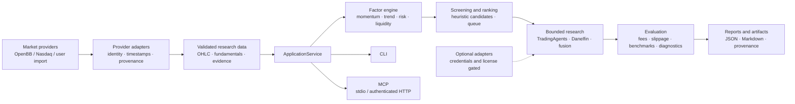

<div align="center">


# Alpha Mosaic

### Modular Quantitative Research & Strategy Evaluation

**Explore signals. Evaluate strategies. Build research you can reproduce.**

[](https://www.python.org/downloads/release/python-3120/)
[](LICENSE)
[](#research-boundaries)

Evidence-first infrastructure for market observations, deterministic factors, candidate research,
paper evaluation, and auditable reports. **No broker connector. No order route. No promise of alpha.**

<a href="#quick-start">Quick start</a> ·
<a href="#architecture">Architecture</a> ·
<a href="#capability-matrix">Capability matrix</a> ·
<a href="#research-workflows">Workflows</a> ·
<a href="#contributing">Contributing</a>

</div>

> Alpha Mosaic is a research toolkit, not a trading product. A heuristic rank is not a return
> probability, a backtest metric is not demonstrated alpha, and a paper result is not a live return.

## Overview

Quantitative experimentation becomes fragile when provider calls, data validation, factor formulas,
model commentary, simulation assumptions, and reports live in separate notebooks. Alpha Mosaic keeps
those concerns explicit in one composable research surface:

```text
source evidence -> validation -> deterministic factors -> candidate ranking
       -> bounded research -> strategy diagnostics -> reports and provenance
```

The project follows four rules:

1. **Evidence first.** Financial values are sourced or remain null. Provider health is not signal validity.
2. **Deterministic research.** Factors, risk checks, ranking, and paper diagnostics are reproducible code.
3. **Explicit uncertainty.** Missing fields, stale data, reconstructed history, and unconfigured
   integrations remain visible in contracts and reports.
4. **Composable boundaries.** ApplicationService is the single orchestration authority; providers and
   optional research engines are adapters behind protocols.

## Why Alpha Mosaic?

Alpha Mosaic is for researchers who want to inspect the chain from input to conclusion. It is narrower
than a broker terminal and more disciplined than an indicator gallery.

| Research need | Alpha Mosaic approach | Boundary |
|---|---|---|
| Bring together market data and research | Provider adapters emit typed, provenance-bearing contracts | Provider terms, quotas, and freshness still apply |
| Screen a current US equity sample | Universe discovery plus deterministic factor ranking | Current listings are survivorship-biased |
| Compare technical and fundamental evidence | Separate factor groups and optional research outcomes | Unavailable fields stay null |
| Evaluate a transparent strategy | Chronological diagnostic with fees and benchmark comparisons | Reconstructed history is not certified PIT data |
| Use AI research safely | TradingAgents and Danelfin adapters fail closed | Credentials and authorization are external |
| Connect an agent interface | Read-only local MCP and authenticated HTTP boundary | ChatGPT remote deployment is not verified |

## Capability matrix

This matrix describes the current repository, not a future roadmap. “Verified” means local acceptance
records or executable tests cover the behavior; it does not mean an external provider is always available.

| Capability | Maturity | What exists now | Evidence or limitation |
|---|---|---|---|
| OpenBB V5 foundation | **Optional / implemented** | Isolated OpenBB core + Nasdaq adapter for universe, history, profile, and optional fundamentals | Provider terms, quota, adjustment policy, and freshness still apply |
| Current US equity discovery | **Implemented** | Bounded current market-cap sample, explicit symbols, imports, and watchlists | Not complete market coverage or historical index membership |
| Historical observations | **Implemented** | HistoricalBar, identity checks, OHLC validation, evidence, and UTC chronology | Retrieved/revised history is reconstructed, not certified PIT |
| Deterministic factors | **Implemented** | Momentum, benchmark-relative strength, trend, volume change, volatility, drawdown, liquidity, quality/value when supplied | Missing fundamentals are not imputed |
| Candidate ranking | **Implemented** | Percentile heuristic rank, risk filters, and research queue | Rank is not a probability or forecast |
| PIT safeguards | **Implemented / limited** | known_at, observed_at, cutoff checks, and future-information rejection | Revisions, delistings, and corporate actions need richer licensed data |
| QuantStats analytics | **Optional / implemented** | Finite return, volatility, drawdown, Sharpe, and Sortino adapter | Requires quantstats; diagnostics are not certification |
| Paper replay | **Implemented / evidence-gated** | PaperReplayEngine, strategy registry, costs, slippage, and forward initialization are present | Certified PIT data and forward observations remain separate gates |
| Strategy baselines | **Implemented / evidence-gated** | Buy-and-hold, momentum, trend, quality, value, multi-factor, AI-rating, and signal-consensus registry entries | AI-rating history is blocked without licensed PIT scores; reconstructed metrics do not certify alpha |
| Benchmark comparison | **Implemented / diagnostic** | SPY and QQQM are requested when aligned histories are available | Missing benchmarks degrade results; no alpha claim |
| TradingAgents | **Optional / ready unconfigured** | Isolated v0.6.0 adapter with FAST/BALANCED/DEEP and structured verdict gate | Package, model keys, data vendors, and cost authorization are external |
| Danelfin | **Optional / ready unconfigured** | Official MCP ClientSession, schema discovery, score validation, cache, quota, timeout | DANELFIN_API_KEY is absent by default; score is not a return probability |
| QuantConnect LEAN | **Optional / blocked by environment** | Isolated local adapter boundary exists | Docker, LEAN CLI, reviewed data, and paid cloud service are not assumed |
| Local CLI | **Implemented** | Doctor, providers, integrations, research, scan, analyze, report, MCP | Network commands depend on provider availability |
| Local MCP | **Verified locally** | Stdio tools and authenticated local Streamable HTTP | Local success does not prove ChatGPT connectivity |
| ChatGPT package | **Implemented / deployment placeholder** | plugins/alphamosaic with four skills and MCP manifest | Remote ChatGPT tool call remains NOT_VERIFIED |

## Architecture

Alpha Mosaic is a modular monolith with one authoritative application service. Domain contracts do
not import CLI, MCP, or provider internals. Optional integrations can run in isolated processes.



The service stops at research output. There is no broker, order, account, shell, or arbitrary-file
tool in MCP. The HTTP app is localhost-bound by default and expects operator-managed HTTPS before
public use.

## Feature highlights

### Market data and evidence

- OpenBB is called through an isolated worker boundary rather than imported throughout domain code.
- SecurityIdentity, HistoricalBar, CompanyFundamentals, ProviderEvidence, and ProviderHealth carry
  source, URL, timestamps, currency, data quality, adjustment policy, and license scope.
- Validation checks identity, chronological order, OHLC envelopes, duplicate sessions, future-known
  information, and missing data. A network failure is a structured failure, never a silent fixture.
- The current universe is bounded and useful for a repeatable research sample, not a claim about every
  listed security or historical index membership.

### Factors and screening

The deterministic factor engine exposes:

- 21-session and 63-session price momentum;
- 20/60-session trend state;
- benchmark-relative 63-session strength when dates align;
- five-versus-20-session volume change;
- annualized volatility, maximum drawdown, and 20-session dollar liquidity;
- return on equity and earnings yield only when valid fundamentals are supplied.

Candidate scores are percentile heuristics. Missing fields remain visible and do not become zeroes or
fabricated averages. Risk filters can exclude an otherwise high-ranked symbol for missing risk inputs,
illiquidity, extreme volatility, or deep drawdown.

### Strategy evaluation and risk

trend_diagnostic is a transparent chronological diagnostic: a fixed SMA20 trend rule, a two-session
signal lag, close-to-close returns, configurable basis-point fees, and optional chronological holdout.
The service compares with SPY and QQQM when aligned histories are available. QuantStats is an
optional adapter for finite return series.

The diagnostic reports return, volatility, maximum drawdown, Sharpe, Sortino, exposure, turnover, fees,
observation count, and limitations. It does not model every microstructure detail and does not certify
a strategy.

### Research integrations

- **TradingAgents** is an optional isolated subprocess. It accepts an explicit structured verdict and
  never extracts direction from prose.
- **Danelfin** uses the documented MCP endpoint and SDK ClientSession flow. It checks advertised tools,
  validates score identity/date/range, caches calls, enforces an interval, and reports missing keys
  as NOT_CONFIGURED.
- **Signal fusion** rejects future, duplicate, shared-dependency, and repackaged evidence. A fused
  direction can be BULLISH, BEARISH, NEUTRAL, CONFLICTED, or INSUFFICIENT_EVIDENCE.
- **SEC and commercial sources** are not automatically available. License, contact, authentication,
  and PIT properties must be reviewed before they become decision inputs.

## Quick start

### Requirements

- Windows, macOS, or Linux
- Python 3.12
- [uv](https://docs.astral.sh/uv/)
- Network access only for commands that use the optional OpenBB provider

```powershell
uv sync --all-extras
```

The base package remains useful for local contract and MCP work. The openbb extra installs the pinned
OpenBB foundation and Nasdaq router; analytics installs QuantStats. Provider data terms and quotas
remain in force even when software is open source.

### First checks

```powershell
uv run alphamosaic doctor
uv run alphamosaic providers
uv run alphamosaic integrations
```

These commands report package availability and boundaries. Installation does not mean that a provider
returned valid market data. The service always reports broker_enabled: false.

### A single stock

```powershell
uv run alphamosaic analyze AAPL --fundamentals
```

The JSON response includes identity, latest bar, optional fundamentals, provider evidence, validation
flags, and an INSUFFICIENT_EVIDENCE default verdict when no sourced conclusion can be formed.

### A bounded current-market scan

```powershell
uv run alphamosaic scan --universe-limit 10 --top 10
```

This makes a bounded provider request, validates returned batches, ranks eligible symbols, and writes
a unique report.json and report.md under ALPHAMOSAIC_HOME (default: runtime). There is no synthetic
padding when fewer than ten symbols qualify. A stale or unavailable provider can produce an empty or
degraded report; that is an expected research outcome.

### Research profiles

```powershell
uv run alphamosaic research AAPL,MSFT,GOOGL --profile FAST
uv run alphamosaic research AAPL,MSFT,GOOGL --profile BALANCED
uv run alphamosaic research AAPL,MSFT,GOOGL --profile DEEP
uv run alphamosaic strategies
uv run alphamosaic backtest AAPL --strategy momentum
uv run alphamosaic forward-init
```

Deep research is bounded to five symbols. Without the optional package, model credentials, or
Danelfin key, those integrations remain explicit NOT_CONFIGURED outcomes while deterministic research
can still be inspected.

## Research workflows

### 1. Single-stock evidence review

```powershell
uv run alphamosaic analyze AAPL --fundamentals > aapl.json
```

Review status, evidence, flags, data_quality, and known_at before reading a factor. REAL or HISTORICAL
is not the same as a certified point-in-time fact.

### 2. Cross-sectional screening

```powershell
uv run alphamosaic scan --universe-limit 30 --top 10
uv run alphamosaic report
```

The scan preserves source evidence and candidate reasons. Markdown is for review; report.json is the
authoritative structured artifact. The default current-listing sample is survivorship-biased and is
not historical index membership.

### 3. Strategy diagnostics

The service-level strategy registry includes transparent buy-and-hold, momentum, trend, quality,
value, multi-factor, AI-rating, and signal-consensus entries. AI-rating history remains blocked
unless a licensed point-in-time score series is available:

```powershell
uv run alphamosaic strategies
uv run alphamosaic backtest AAPL --strategy momentum --fee-bps 10 --slippage-bps 5
uv run alphamosaic forward-init
```

The backtest command runs a sourced reconstructed-history replay and reports its acceptance boundary.
The forward initializer creates an empty isolated paper record; it does not create fills or returns.
Historical statistics, forward paper observations, and real-account performance remain separate.

## Output showcase: evidence before performance claims

Reports are shaped around reviewable facts rather than a marketing scorecard. A typical candidate
record contains:

```json
{
  "ticker": "AAPL",
  "rank": 1,
  "score": 0.82,
  "factors": {
    "momentum_63d": 0.12,
    "relative_strength_spy_63d": null,
    "trend_20_60": 0.04,
    "quality_roe": null,
    "value_earnings_yield": null
  },
  "missing_fields": ["relative_strength_spy_63d", "quality_roe", "value_earnings_yield"],
  "risks": ["HEURISTIC_SCORE_NOT_RETURN_PROBABILITY", "NO_VALIDATED_ALPHA"],
  "data_quality": "HISTORICAL"
}
```

The values are **schema-shaped illustration only**, not a live result or fixture acceptance claim.
Real reports retain provider evidence and timestamps. If a field is unavailable, the correct output is
null plus a missing reason.

For a real or reconstructed diagnostic, inspect acceptance, provider evidence, benchmark status,
observation count, fees, turnover, and limitations together. A single Sharpe ratio or cumulative
return cannot establish investment edge.

## Strategy laboratory

The current service-level registry is intentionally small:

| Strategy name | Current state | Interpretation |
|---|---|---|
| momentum | Implemented diagnostic | Fixed chronological factor path with fees and optional holdout |
| trend | Registered baseline | Reconstructed-history diagnostic with costs |
| buy_and_hold | Registered baseline | Transparent reference strategy |
| Quality / Value / Multi-factor | Registered baseline | Requires sourced fields and explicit coverage |
| AI rating / signal consensus | Registered but gated | Historical AI scores require licensed PIT history |

Assumptions are chronological observations, signal lag, fees, slippage, benchmark alignment, and no
broker execution. Limitations include adjustment policy, corporate actions, delistings, survivorship,
spread, market impact, financing, and retrieval time versus historical publication time.

## Integration ecosystem

| Component | Purpose | Type | Current readiness | Configuration and restrictions |
|---|---|---|---|---|
| OpenBB V5 foundation | Universe, OHLCV, profile, optional fundamentals | Optional adapter / worker | ACTIVE when installed | Provider terms, quotas, data entitlement |
| QuantStats | Finite return analytics | Optional adapter | Available when installed | No downloads or performance certification |
| TradingAgents v0.6.0 | Bounded multi-agent research | Optional worker | READY_UNCONFIGURED | Package, model keys, data vendors, upstream terms |
| Danelfin MCP | AI score, ranking, history, screening | Official remote MCP | READY_UNCONFIGURED | DANELFIN_API_KEY; score is not return probability |
| QuantConnect LEAN | Professional engine boundary | Not bundled | BLOCKED | No Docker, cloud service, licensed data, or purchase |
| MCP | Read-only interface | Local stdio + authenticated HTTP | Local tested | Remote deployment and HTTPS are operator responsibilities |
| ChatGPT package | Four skills and MCP manifest | Portable package | Local package implemented | URL remains a deployment placeholder |
| AI Hedge Fund | External research project | Registry entry | EXPERIMENTAL | No stable entitlement-safe adapter |
| FINVIZ / TradingView / TIKR / Seeking Alpha | Commercial sources | Registry entries | LICENSE_BLOCKED | No scraping; use licensed import only |

Provider software licenses do not grant redistribution rights to provider data. See
[INTEGRATIONS.md](INTEGRATIONS.md) and [LICENSE_REVIEW.md](LICENSE_REVIEW.md).

## CLI and MCP

### CLI surface

The CLI is a thin interface over ApplicationService:

```text
doctor          installation and permission status
providers       provider health and capability boundary
integrations    upstream and commercial registry
analyze         one evidence-labelled stock snapshot
scan            bounded universe discovery and ranking
research        bounded multi-source research
strategies      transparent strategy registry and engine states
backtest        reconstructed-history strategy diagnostic
forward-init    empty isolated paper record initialization
report          latest local report
mcp serve       local stdio MCP server
```

### Local stdio MCP

```powershell
uv run alphamosaic mcp serve
```

The server exposes read-only tools including system_status, provider_health, scan_market,
rank_opportunities, analyze_stock, compare_stocks, research_portfolio, job_status,
evaluate_strategy, run_backtest, get_signal_history, get_forward_performance, and
generate_investment_report. Long research is bounded behind a job ID. No tool reads arbitrary files,
executes shell commands, retrieves credentials, or places orders.

### Authenticated Streamable HTTP

```powershell
$env:ALPHAMOSAIC_MCP_TOKEN = "choose-a-local-token-at-least-16-chars"
$env:ALPHAMOSAIC_AUDIT_LOG = "runtime\mcp-audit.jsonl"
uv run python -m alphamosaic.mcp.remote
```

The app validates a bearer token, limits request size and rate, rejects insecure non-local traffic
unless explicitly allowed for localhost, sets safe cache headers, and can write redacted audit
metadata. Put a public endpoint behind HTTPS and an operator-controlled identity layer. The repository
has **not** completed a remote ChatGPT tool call; status remains NOT_VERIFIED.

## Project structure

```text
src/alphamosaic/
├── core/             Pydantic contracts and ApplicationService
├── data/             data-quality and chronology validation
├── providers/        DataProvider protocol and OpenBB boundary
├── factors/          deterministic factor calculations
├── screening/        universe management and candidate ranking
├── research_engine.py bounded multi-source research orchestration
├── signals_fusion.py dependency-aware signal fusion
├── backtesting/      replay engine, strategy baselines, and diagnostics
├── evaluation/       optional QuantStats metrics adapter
├── portfolio/        review-only risk checks and forward paper store
├── reporting/        JSON/Markdown run bundles
├── integrations/     TradingAgents, Danelfin, worker, registry
├── mcp/              local and authenticated Streamable HTTP MCP
└── cli/              Typer commands
plugins/alphamosaic/  portable manifest and four MCP-backed skills
tests/                contract, integration, fusion, and remote-boundary tests
docs/                 acceptance evidence and audit notes
```

## Research boundaries

| Statement | Correct interpretation |
|---|---|
| Research signal | Sourced or model-labelled observation under a stated cutoff |
| Heuristic score | Deterministic ordering aid; not a probability of gain |
| Historical diagnostic | Replay of retrieved data under declared assumptions |
| Point-in-time dataset | Requires publication-time and revision controls beyond reconstructed history |
| Fixture test | Contract verification, not real-data validation |
| Paper evaluation | Simulated research observation, not account return |
| Configured integration | Credentials are present; data still needs validation |
| Verified integration | Authorized call succeeded and response passed the contract |

When evidence is insufficient, Alpha Mosaic should return INSUFFICIENT_EVIDENCE, DEGRADED,
NOT_CONFIGURED, or NO_ACTION. It should not fill gaps with language-model prose, current scores
backfilled into history, or invented price levels.

## Maturity and roadmap

### Available now

- typed evidence contracts and one application service;
- bounded current-universe discovery and deterministic screening;
- optional OpenBB/Nasdaq market data, profile, and fundamentals;
- transparent factor and risk diagnostics;
- evidence-gated PaperReplayEngine, baseline strategy registry, and empty forward-paper initialization;
- local CLI, stdio MCP, and authenticated local HTTP MCP;
- optional Danelfin and TradingAgents adapters with fail-closed behavior;
- JSON/Markdown reports and a research-only safety boundary.

### Experimental or constrained

- reconstructed historical data and current-listing samples;
- optional external engines without default credentials;
- QuantStats diagnostics without a certified performance dataset;
- commercial registry entries without scraping or redistribution rights.

### Planned

- licensed point-in-time fundamentals, corporate actions, and delisting coverage;
- reviewed paper-observation store with append-only maturity rules;
- stronger historical universe membership and survivorship controls;
- additional transparent strategy registrations and walk-forward evidence;
- operator-managed HTTPS deployment followed by a genuine ChatGPT end-to-end test.

Read [CURRENT_STATE.md](CURRENT_STATE.md) and [NEXT_STEPS.md](NEXT_STEPS.md) for measured checkpoints
and blockers. Planned work is not current capability.

## Developer documentation

- [ARCHITECTURE.md](ARCHITECTURE.md) — boundaries, service ownership, and transport security.
- [INTEGRATIONS.md](INTEGRATIONS.md) — upstream adapters, maturity, and official references.
- [DEVELOPMENT.md](DEVELOPMENT.md) — environment, checks, and contribution workflow.
- [CURRENT_STATE.md](CURRENT_STATE.md) — acceptance history and current limitations.
- [FINAL_ACCEPTANCE.md](FINAL_ACCEPTANCE.md) — local acceptance and explicit non-claims.
- [NEXT_STEPS.md](NEXT_STEPS.md) — prioritized engineering work.
- [LICENSE_REVIEW.md](LICENSE_REVIEW.md) — Apache 2.0 and provider-data boundaries.
- [docs/acceptance/openbb-aapl-2026-10-09.json](docs/acceptance/openbb-aapl-2026-10-09.json) — source-backed OpenBB acceptance snapshot.
- [docs/BACKTESTING_ACCEPTANCE.md](docs/BACKTESTING_ACCEPTANCE.md) — strategy evaluation boundaries and acceptance evidence.
- [docs/framework-review-sources.json](docs/framework-review-sources.json) — reviewed external framework sources.

## Contributing

Contributions should preserve the evidence boundary:

1. Keep domain code independent from provider, CLI, and MCP internals.
2. Add tests for valid data and failure paths, especially stale, missing, duplicate, future, or
   identity-mismatched observations.
3. Keep financial values sourced or null. Label fixture, historical, delayed, and model-inference
   data explicitly.
4. Do not add broker routes, credential retrieval, arbitrary shell/file tools, or real-account data.
5. Run the checks in [DEVELOPMENT.md](DEVELOPMENT.md), inspect the diff, and avoid committing runtime
   reports, caches, tokens, or private data.

Please open an issue with a minimal reproduction, provider terms, and expected evidence status when
reporting a data-quality or integration problem.

## License

Alpha Mosaic is released under the [Apache License 2.0](LICENSE). Third-party software and market
data retain their own licenses and service terms. Installing an adapter does not grant permission to
redistribute provider data or bypass a commercial plan.

<div align="center">

**Research infrastructure first. Claims only when the evidence earns them.**

</div>
